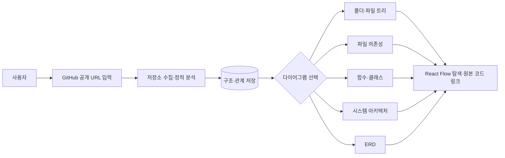
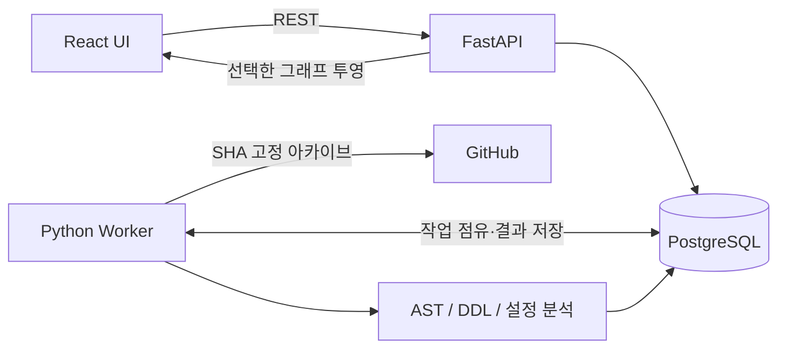

# RepoAtlas

> **GitHub 저장소의 코드를 읽고, 유지보수 인수인계에 필요한 구조도를 선택해 생성하는 웹서비스**
>
> 상태: **Worker·DB 구현 / API·화면 구현 전** · 목표: **21일 MVP**

## 5분 소개

새 담당자가 생소한 GitHub 프로젝트를 인계받으면 폴더, 함수, import 관계, 배포 구성, DB 모델을 직접 읽느라 시간이 걸립니다. **RepoAtlas**는 공개 GitHub 저장소 URL을 받아 **해당 커밋의 소스 구조를 정적 분석**한 후, 사용자가 선택한 다이어그램을 웹에서 탐색하게 합니다.

**핵심 사용자:** 기존 프로젝트 유지보수 담당자, 새 팀원, 코드 리뷰에 들어가기 전 아키텍처를 이해하려는 개발자.



## 실제로 무엇을 보여 주나?

| 선택 다이어그램 | 의미 | 3주 목표 | 주의 |
|---|---|---|---|
| `directory` | 디렉터리→파일 계층 | **Must** | GitHub 아카이브에 포함된 추적 파일 대상 |
| `dependency` | 파일 간 정적 `import` | **Must** | 대상 경로를 해석한 내부 참조만 연결 |
| `symbols` | 파일→클래스/함수/메서드 | **Must** | 함수 **호출** 그래프 아님 |
| `architecture` | 프론트/백엔드/서비스/DB의 구성 | **Should** | Docker Compose·프레임워크·설정의 **근거가 확인된 범위**만; 추론은 표시 |
| `erd` | 테이블·컬럼·PK·FK | **Should** | SQL DDL 우선; **실제 운영 DB를 조회한 ERD가 아님** |

**예시:** `src/main.py`를 클릭하면 정의된 함수와 import 목록, 증거 위치(파일·라인)를 확인하고, import로 연결된 다른 파일을 클릭할 수 있습니다. 다이어그램에 근거가 없다면 조작된 그림을 만들지 않고 `unsupported` 또는 `partial`을 표시합니다.

## 이번 MVP에 포함하지 않는 것

AI 채팅·코드 리뷰·자동 수정·코드 생성, 비공개 저장소/OAuth, 동적 런타임 추적, 모든 언어의 완벽한 호출 그래프, 배포 환경 실측, 여러 커밋 비교. Java/C/C++/Go 등의 파일은 목록에는 나오지만 **심층 AST와 import 분석은 후속 범위**입니다.

## 기술 스택 한눈에

- **Frontend:** React, TypeScript, Vite, Tailwind CSS, React Flow (`@xyflow/react`), Dagre, TanStack Query
- **Backend:** FastAPI, Pydantic, SQLAlchemy, Alembic
- **Analyzer:** Python 표준 `ast` (Python), Tree-sitter (JS/JSX/TS/TSX), SQLGlot (PostgreSQL DDL), 안전한 YAML/JSON 읽기
- **Data / Jobs:** PostgreSQL; **별도 Python Worker**가 DB의 분석 작업을 처리함 (Redis·Celery·Neo4j 제외)
- **Deploy / Test:** Docker Compose, Nginx, pytest, Vitest

기술 선정 및 트레이드오프: [TECH_STACK.md](docs/TECH_STACK.md).

## 사용 흐름

1. 공개 `https://github.com/{owner}/{repo}` URL을 등록합니다.
2. 기본 브랜치의 커밋 SHA를 고정하여 아카이브를 수집하고 분석을 큐에 등록합니다.
3. 사용자는 `queued → fetching → parsing → resolving → completed/partial/failed` 진행 상태를 확인합니다.
4. 완료 후 다이어그램 종류와 폴더/파일/언어 필터를 선택합니다.
5. 노드·간선을 탐색하며 GitHub **고정 SHA permalink**로 실제 근거 코드를 확인합니다.

## 시스템 구성



**중요:** 수집한 저장소의 코드를 실행하지 않습니다. Worker는 크기·시간 제한을 적용하며, 운영 시 별도 프로세스 격리와 메모리 제한이 필요합니다.

## 저장소 디렉터리 구조 (개발 목표)

```text
repoatlas/
├── frontend/                 # React SPA (구현 예정)
├── backend/                  # DB 모델·migration 구현; FastAPI 구현 예정
├── worker/                   # 독립 분석 프로세스 및 JSON 테스트 명령
├── infra/                    # Compose/Nginx (구현 예정)
├── README.md
└── docs/                     # 설계 문서
```

> Worker와 DB 모델·migration은 실행할 수 있습니다. FastAPI, 프론트엔드, Compose 배포는 아직 구현되지 않았습니다.

## Worker 실행

```bash
uv sync --locked
uv run python -m worker.cli https://github.com/psf/requests --output analysis-output/requests.json
```

위 명령은 DB 없이 분석 결과를 JSON으로 저장합니다. DB 생성·migration과 작업 처리 명령은 [DB 운영 가이드](docs/DATABASE_OPERATIONS.md), [Worker 실행 가이드](docs/WORKER.md)를 참고합니다.

## 21일 일정

| 주차 | 결과물 |
|---|---|
| 1주차 | GitHub 수집 → Python/JS/TS AST 분석 → PostgreSQL 저장 및 상태 API |
| 2주차 | `directory`/`dependency`/`symbols` 그래프 UI, 선택·검색·근거 링크 |
| 3주차 | 제한적 `architecture`·`erd` 생성, 통합 테스트, 성능/보안, 시연 배포 |

세부 Day 1~21: [PROJECT_PLAN.md](docs/PROJECT_PLAN.md).

## 문서 읽는 순서

1. **[FEATURE_SPEC.md](docs/FEATURE_SPEC.md)** — 사용자가 무엇을 하는가 / 우선순위
2. **[ARCHITECTURE.md](docs/ARCHITECTURE.md)** — 전체 시스템과 데이터 흐름
3. **[CODE_ANALYSIS.md](docs/CODE_ANALYSIS.md)** — 어떤 근거로 관계를 만드는가
4. **[API_SPEC.md](docs/API_SPEC.md)** — 프론트/백엔드 사이 요청·응답 계약
5. **[DB_SCHEMA.md](docs/DB_SCHEMA.md)** / **[ERD.md](docs/ERD.md)** — 테이블 DDL·관계
6. **[TECH_STACK.md](docs/TECH_STACK.md)** — 라이브러리 결정과 대안
7. **[PROJECT_PLAN.md](docs/PROJECT_PLAN.md)** / **[DEVELOPMENT_GUIDE.md](docs/DEVELOPMENT_GUIDE.md)** — 일정과 작업 방식

## 완료 기준

- 최소 3개의 공개 fixture 저장소에서 파일 트리 및 지원 언어의 심볼이 재현 가능하게 표시됨
- 정적 내부 import 테스트 30개 이상에서 **정답 파일 연결 precision 95% 이상** (해석 불가 항목은 분모·분자 별도 공개)
- 5종 다이어그램을 선택할 수 있고, 지원 불충분 시 상태/경고/근거를 정확히 보여줌
- 분석 실패·재시도·캐시 재사용과 시연 배포 성공

계약을 바꾸는 경우 **API_SPEC ↔ DB_SCHEMA ↔ FEATURE_SPEC ↔ CODE_ANALYSIS**를 같은 PR에서 함께 수정합니다.
