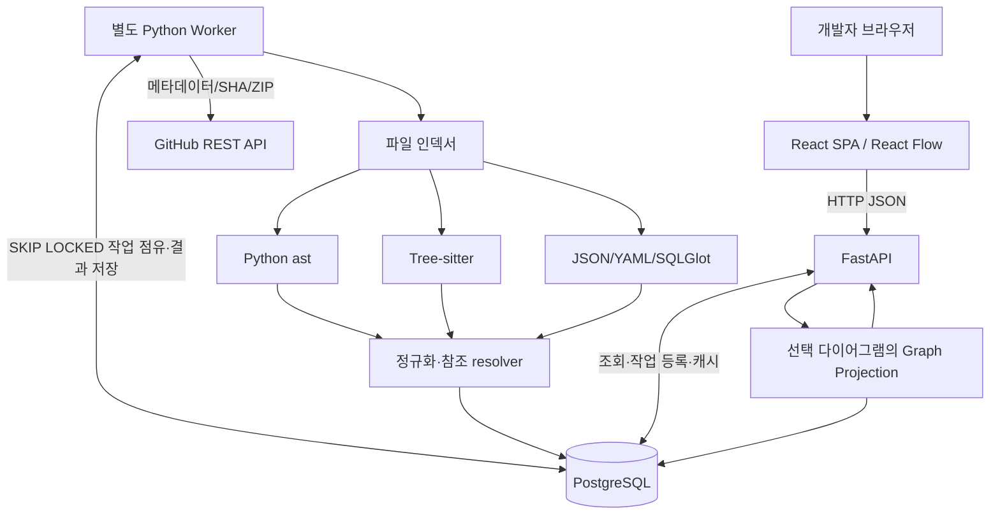
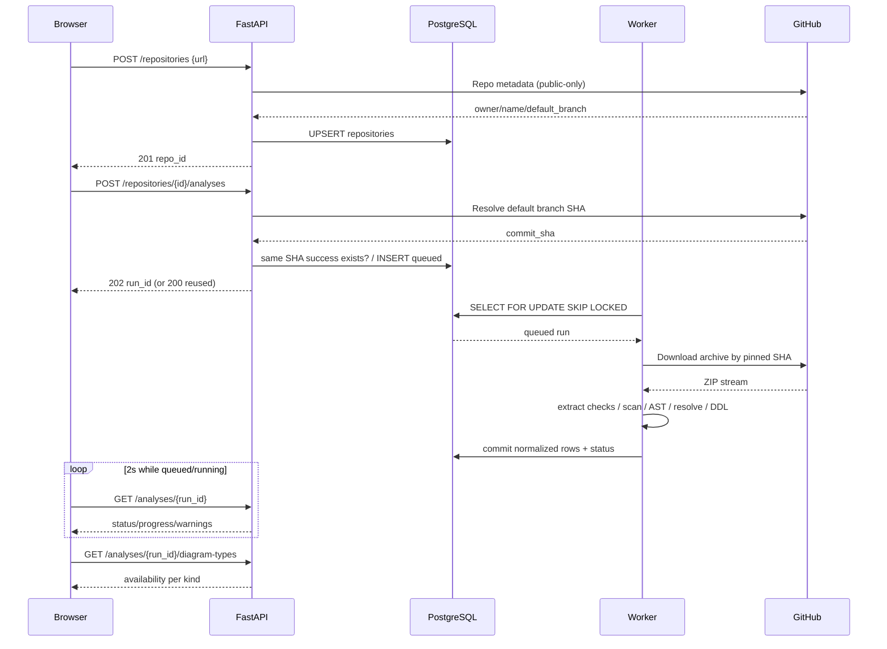
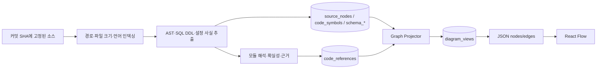
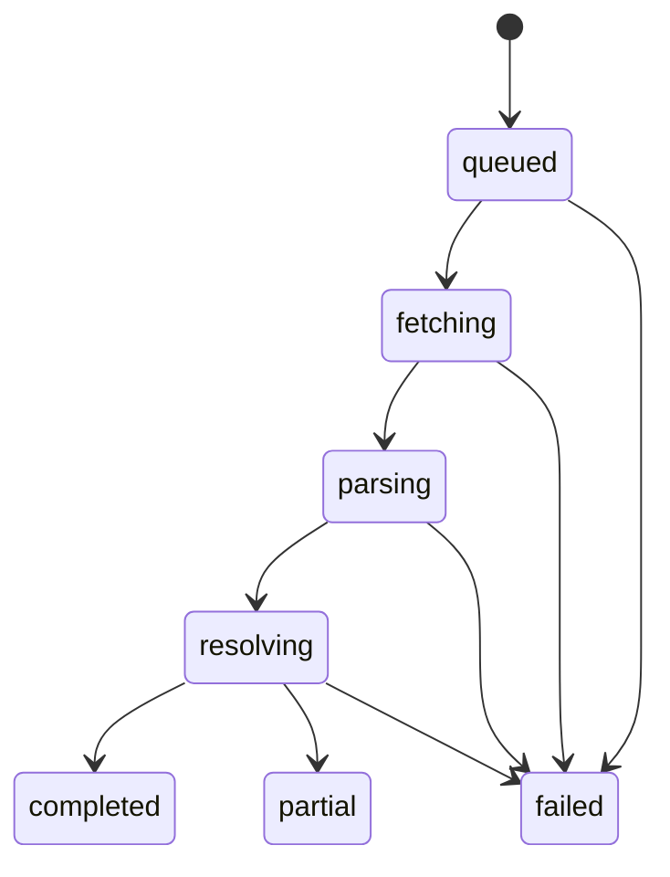

# 시스템 아키텍처 (ARCHITECTURE)

[← README](../README.md) · [데이터 분석](CODE_ANALYSIS.md) · [DB](DB_SCHEMA.md) · [API](API_SPEC.md)

## 1. 논리 구조

**배포 단위:** Nginx(web 정적 배포 및 `/api` 리버스 프록시), FastAPI 서버, Python Worker, PostgreSQL. Docker Compose의 4개 서비스. 별도 Redis/Neo4j/Kubernetes 불필요.

## 2. 등록에서 분석 완료까지 (Sequence)

## 3. 소스 → 그래프 데이터

- **인덱싱:** 디렉터리/파일은 `source_nodes`; 지원하지 않는 확장자도 목록에 포함. `parse_status`로 분석 범위 표시.
- **심볼:** 파일 내부 함수/클래스/메서드를 `code_symbols`; `parent_symbol_id`는 포함 관계를 의미. 호출 정보가 아님.
- **참조:** `code_references`에 import 문자열·원본 줄·해결 상태 저장. 내부 파일 해석이 확인되면 `target_file_id` 지정.
- **ERD:** SQL DDL에서 추출한 정적 테이블/컬럼/FK를 `schema_*`에 저장. 실행 중인 DB에 접근하지 않음.
- **아키텍처:** `source_nodes.metadata`에 안전한 정적 설정 사실(Compose 서비스/의존성, 프레임워크 단서)을 저장; 생성 요청 시 이 정보를 투영하며 불충분하면 unsupported.
- **그래프 캐시:** `diagram_views`는 `(run_id, diagram_type, options_hash)`별 node/edge JSON 스냅샷. 같은 SHA·옵션 재조회 시 빠르게 반환.

## 4. 작업 상태 머신

`completed`: 수집 성공, 분석에서 심각한 누락 없음. `partial`: 제한되지 않은 전체 목록은 확보했지만 일부 지원 소스의 파싱 실패·관계 해석 누락 등 경고가 있음. `failed`: 수집·보안·리소스 제한이나 치명적 분석 실패. 실패한 실행은 그래프 생성 불가.

분석 완료 DB 반영은 **단일 트랜잭션**에서 수행. 작업 중 Worker가 죽으면 stale heartbeat을 감지해 한 번 재시도한 후 `failed` 처리. `completed` 스냅샷은 새 커밋 재분석에 의해 수정되지 않음.

## 5. 다이어그램 생성 조건

| type | DB 읽기 | 생성 조건 | 리턴 정책 |
|---|---|---|---|
| directory | `source_nodes` | 인덱싱 성공 | `available` |
| dependency | `source_nodes`, `code_references` | 지원 파일 분석 있음 | 0간선이면 안내 및 빈 결과 |
| symbols | `source_nodes`, `code_symbols` | `file_id` 유효 | 해당 파일 심볼 0개도 정상 |
| architecture | `source_nodes.metadata` | 정적 설정 단서 있음 | 없으면 `unsupported` |
| erd | `schema_tables`, `schema_columns`, `schema_foreign_keys` | SQL 스키마 추출 성공 | 없으면 `unsupported` |

`available`이라도 경고가 있으면 `coverage="partial"`로 반환. 표시 간선에는 `certainty`, `evidence`. 그래프 첫 화면 기본 150노드/요청 최대 300노드. 많은 노드는 `truncated=true`로 사용자에게 필터/깊이 조정 유도.

## 6. 보안 및 비용 통제

1. **URL 허용:** URL parser로 `https://github.com/owner/repo`의 정확한 형식만 수락; URL userinfo/포트/query/fragment/path traversal/기타 호스트 거절. Github API와 codeload redirect 호스트만 명시적으로 허용.
2. **네트워크:** 백엔드는 GitHub 공식 API만 조회. 외부가 제공한 임의 Redirect로 연결하지 않고 최종 호스트/IP 검증; 사설·loopback·metadata IP 차단.
3. **ZIP 검사:** `..`, 절대경로, 비정상 압축률과 파일 수를 차단한다. ZIP을 파일 시스템에 풀지 않으며, symlink는 경로만 `skipped`로 색인하고 내용을 읽거나 따라가지 않은 채 경고한다.
4. **자원 제한(초깃값):** ZIP 512 MiB, 추출 총량 2 GiB, 파일 100,000개, AST 대상 파일당 1 MiB, 실행 900초, 동시 Worker 1. 대형 저장소 분석 결과도 메모리와 디스크를 사용하므로 운영 자원에 맞게 제한한다.
5. **실행 격리:** 분석 대상 코드/스크립트를 실행하지 않음; `npm install`, `pip install`, `git hook`, `docker compose up` 등 금지. Worker는 rootless, read-only root FS, 제한된 tmp 디렉터리, CPU/memory/PID 제한, host socket·비밀 환경변수 접근 금지.
6. **공개 서비스 남용 대응:** 인증 미구현 기간에는 서버에서 rate limit과 허용 크기/동시성 제한, 고정 공개 데모 저장소로 노출 범위를 제어.
7. **정보 보관:** 소스 원문·설정의 비밀번호·토큰을 DB에 저장하지 않음. SHA, 경로, 정의 위치, 필터링된 설정 사실, 참조 문자열만 보관. 임시 파일은 분석 종료 시 삭제.

## 7. 데이터 정합성

**커밋 SHA:** run 생성 전에 고정. 브랜치 HEAD가 이후 변경되어도 분석 내용·GitHub permalink는 동일 SHA 참조. `repositories`는 메타데이터, `analysis_runs`는 불변 분석 스냅샷. 동일 SHA의 완료 분석은 재사용.

**다이어그램 재생성:** 캐시 키는 정규화된 옵션 JSON(`sort_keys`, 일관된 depth/max_nodes, 파서 스키마 버전 포함)의 SHA-256. 다른 필터 옵션은 다른 캐시 생성. `diagram_views.payload`는 단일 Graph DTO 형식.

## 8. 주요 실패 처리

- GitHub 404/403/429 → 재시도 가능한 오류인지 분류하고 적절한 `error_code`, `retry_after`를 기록.
- ZIP 크기/압축 해제 제한 → 작업 `failed`, 그래프 없음.
- 개별 구문 분석 실패 → `partial`, 해당 파일 `parse_status=failed`, 나머지는 공개.
- 파서가 import 대상 결정 못 함 → `resolution_status=unresolved`, 임의 연결 금지.
- Compose 설정의 환경 변수 참조 등 → 값 자체를 실행/확장하지 않고 단서만 기록, `inferred` 등으로 처리.
