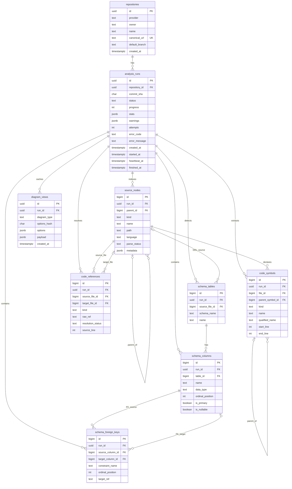

# ERD — RepoAtlas 내부 메타데이터 DB

[← README](../README.md) · [DDL·컬럼·인덱스](DB_SCHEMA.md) · [외부 저장소에서 생성할 ERD 규칙](CODE_ANALYSIS.md#7-erd-생성-규칙-제한형)

> 아래 ERD는 RepoAtlas **서비스 자체의 PostgreSQL DB 구조**입니다. 사용자가 GitHub 저장소를 넣었을 때 생성되는 **대상 프로젝트 ERD**와 구별하세요.

## 관계 선택의 이유

| 관계 | 이유/제약 |
|---|---|
| `repositories → analysis_runs` (1:N) | 동일 저장소의 여러 커밋 스냅샷을 독립적으로 보관 |
| `analysis_runs → source_nodes` (1:N) | 인덱싱 대상 파일이 분석 실행의 결과임을 표시 |
| `source_nodes → source_nodes` (self 1:N) | 파일 트리의 부모·자식 계층 |
| `source_nodes → code_symbols` (1:N) | 소스 파일별 함수·클래스 정의 |
| `code_symbols → code_symbols` (self 1:N) | 클래스→메서드·중첩 함수 등의 포함 구조 |
| `source_nodes → code_references` (두 FK) | 정적 import의 시작 파일과 (있는 경우) 해결된 대상 파일 |
| `schema_tables → schema_columns` (1:N) | 대상 프로젝트에서 추출한 테이블과 컬럼 |
| `schema_columns → schema_foreign_keys` (시작·대상) | 복합 FK 컬럼쌍 포함. 미해결 FK의 target은 NULL 허용 |
| `analysis_runs → diagram_views` (1:N) | 다이어그램 종류·옵션별 캐시 |

복합 FK `(run_id, child_id)`를 통해 서로 다른 run의 노드·컬럼을 엉뚱하게 연결하지 못하도록 제한합니다. Mermaid 문법은 여러 컬럼으로 된 복합 FK 전체를 표현하기 어렵기 때문에 정확한 관계 제약은 [DB_SCHEMA.md](DB_SCHEMA.md)의 DDL이 우선합니다.

`source_nodes.path`의 유일성은 경로 단독이 아닌 `(run_id, path)` 조합에 적용됩니다. 파일 참조가 실제 파일 노드를 가리키는지는 워커의 저장 단계에서 검증합니다. DB에 직접 쓰거나 다른 저장 경로를 추가할 때는 같은 검증이 필요합니다.

## DB와 화면의 매핑

- **트리 화면:** `source_nodes.parent_id`.
- **파일 의존성:** `code_references`에서 `resolution_status='resolved'`인 간선.
- **심볼 화면:** `code_symbols` + `parent_symbol_id`.
- **시스템 아키텍처:** `source_nodes.metadata.config_facts` → 요청 시 투영; 별도 아키텍처 원본 테이블은 만들지 않음.
- **ERD 화면:** `schema_tables` + `schema_columns` + `schema_foreign_keys`.
- **그래프 재조회:** `diagram_views.payload`.

**삭제:** `analysis_runs` 삭제 시 하위 분석 자료와 다이어그램 캐시가 연쇄 삭제됩니다. 소스 전문·원본 ZIP은 저장하지 않습니다.
