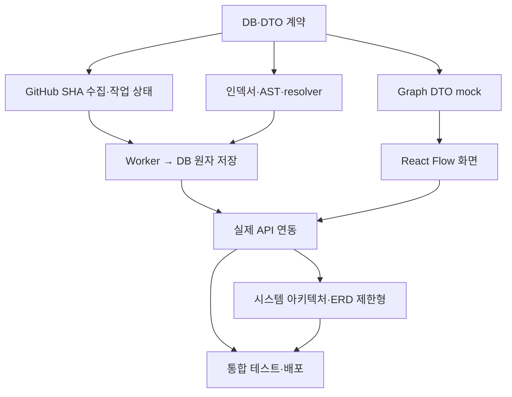

# 21일 개발 계획 (PROJECT_PLAN)

[← README](../README.md) · [기능 범위](FEATURE_SPEC.md) · [개발 가이드](DEVELOPMENT_GUIDE.md)

## 1. 목표·성공 조건

- **21일 내 시연 가능한 MVP**, 가정: 개발자 **2~3명**, 각자 작업을 병렬로 진행할 수 있는 환경.
- 우선순위: **Must** `directory`, `dependency`, `symbols`, GitHub 등록·상태·근거 링크·검색. **Should** 제한형 `architecture`, `erd`, 그래프 내보내기. AI 코드 수정 등은 **Out**.
- 종료 조건: 공개 fixture 3개를 분석하고, 3종 Must 다이어그램이 브라우저에서 작동. Should는 최소 하나의 검증된 fixture에서 결과를 만들고 다른 케이스에서는 unsupported를 정확하게 보여줌.
- 명확한 품질 지표: 내부 정적 import 연결 precision ≥95% (고정된 테스트 30개 이상); 분석 실패/캐시 재사용/재시도/보안 검사 통과.

## 2. 의존 관계

## 3. Day 1 ~ Day 21

| Day | 우선순위 | 작업 | 의존 | 당일 산출물 / DoD |
|---:|---|---|---|---|
| 1 | Must | 요구사항·API DTO/DB 확정, 개발 환경 고정 | - | OpenAPI 모델 초안·DB migration 기본 적용 |
| 2 | Must | Backend skeleton, DB 연결·Alembic·건강 체크 | D1 | `/healthz`, `GET /repositories` 단위 테스트 |
| 3 | Must | GitHub URL 검증·Repo metadata 등록 | D2 | A01~A03 동작, URL/403/404 테스트 |
| 4 | Must | SHA 고정·분석 요청·중복 캐시·Worker 점유 | D2 | A04~A06, queued→fetching 수락 테스트 |
| 5 | Must | 아카이브 안전 다운로드/추출·전체 경로 인덱싱 | D4 | 폴더/파일 fixture 결과 저장, zip-slip 차단 |
| 6 | Must | Python `ast` + JS/TS Tree-sitter 심볼 추출 | D5 | 함수/클래스/메서드 fixture 테스트 |
| 7 | Must | import resolver·DB 원자 저장·통계·오류 처리 | D6 | 1차 E2E: URL→run→DB 결과 조회 |
| 8 | Must | Frontend shell, 라우팅, Query client, 화면 틀 | D1 | URL 입력·저장소 목록 mock |
| 9 | Must | 분석 상태 페이지·폴링·오류 처리 | D4/D8 | queued/partial/failed 상태 UI |
| 10 | Must | 파일 트리 데이터 API·컴포넌트 | D7 | depth/path 필터로 폴더 확장·탐색 |
| 11 | Must | React Flow 노드/간선·Dagre 배치 | D10 | directory 인터랙션 150 노드 시연 |
| 12 | Must | dependency 그래프·연결 강조·근거 클릭 | D7/D11 | 정적 내부 import 그래프 시연 |
| 13 | Must | symbols 그래프·파일 상세 패널 | D6/D11 | 클래스/메서드 계층 확인 |
| 14 | Must | Diagram API·검색/필터·통합 연결 | D12/D13 | 3종 Must 다이어그램 E2E 성공 |
| 15 | Should | 설정 스캐너(Compose/package/FastAPI) | D7 | 구성요소 단서·근거 추출, 비밀값 제거 |
| 16 | Should | architecture projection·가용성 표시 | D15 | 알려진 Compose fixture에서 근거 포함 그래프 |
| 17 | Should | SQLGlot DDL·ERD projection | D7 | PK/FK fixture + unsupported 처리 |
| 18 | Must | 대규모/보안 제한·타임아웃·재시도 | D14 | 제한 초과/비정상 ZIP 테스트 |
| 19 | Must | 30+ import fixture 정확도·API 통합 테스트 | D14 | precision/recall 측정표, 오류 수정 |
| 20 | Must | Docker Compose/Nginx 배포·smoke test | D18/D19 | 실제 브라우저 시연 1회 성공 |
| 21 | Must | 회귀 테스트·최종 문서/인수인계 | D20 | 데모 체크리스트, Known Limitations, 발표 영상 |

> Day 1~7에 API/DB 담당이 분석 엔진을, UI 담당이 Graph DTO mock과 UI shell을 **병렬로 개발**하면 일정 부담을 줄일 수 있습니다. 위 일정의 선행 표기는 해당 기능이 준비되어야 한다는 의미입니다.

## 4. 담당자 분담 예시

- **Backend/DB:** GitHub 메타데이터, A01~A12 REST, 마이그레이션, 작업 상태·캐시, 배포.
- **Analyzer:** 안전한 수집/압축해제, Python/Tree-sitter AST, import resolver, SQL/설정 추출, fixture.
- **Frontend:** 페이지·React Flow·필터·검색·상태 표시·코드 permalink.
- 2인 팀이면 Backend+Analyzer를 한 담당으로 묶고 Should 범위를 축소.

## 5. 리스크 및 제거 순서

| 위험 | 조기 감지 | 대응 | 지연 시 |
|---|---|---|---|
| 언어별 import 해석 모호 | Day 6 fixture 실패 | 지원하는 정적 패턴만 명시 | alias/동적 import 완전 제외 |
| 코드/압축 크기 초과 | Day 5 대형 fixture | 크기/시간/파일수 제한 | 허용 범위 축소, 경고 노출 |
| 그래프 과밀/성능 | Day 11 150 노드 시연 | depth, max_nodes, 검색 | 자동 배치 레이아웃 단순화 |
| 시스템 구조 근거 부족 | Day 15 단서 거의 없음 | compose 기반만 | **architecture 투영 제외**, disabled 표시 |
| ERD SQL 방언/복합 FK | Day 17 파싱 실패 | PostgreSQL SQL DDL만 | **erd 제외**, reason 제공 |
| 21일 미완료 | Day 14 Must 통합 실패 | Should 개발 즉시 중단 | Export → ERD → architecture 순 제거 |

## 6. 완료 기준 (Definition of Done)

**API:** 엔드포인트별 성공·주요 에러 테스트, JSON 스키마와 Pydantic 일치, DB migration 수행.

**파서:** fixture별 expected symbols/relations, unresolved 참조의 가짜 간선 0건, source permalink 검증.

**UI:** 저장소 선택→분석 요청→상태 확인→3종 그래프 생성→노드 클릭→GitHub 원본 확인, 로딩/빈 결과/오류 메시지.

**운영:** 애플리케이션 시작·헬스 체크, 작업 중단 복구, 시연 저장소 재분석, 로그에 민감 데이터 비포함.

**팀 인계:** README 첫 화면에서 서비스 목표·범위·API/DB 문서 진입 가능, Known Limitations 공유.
